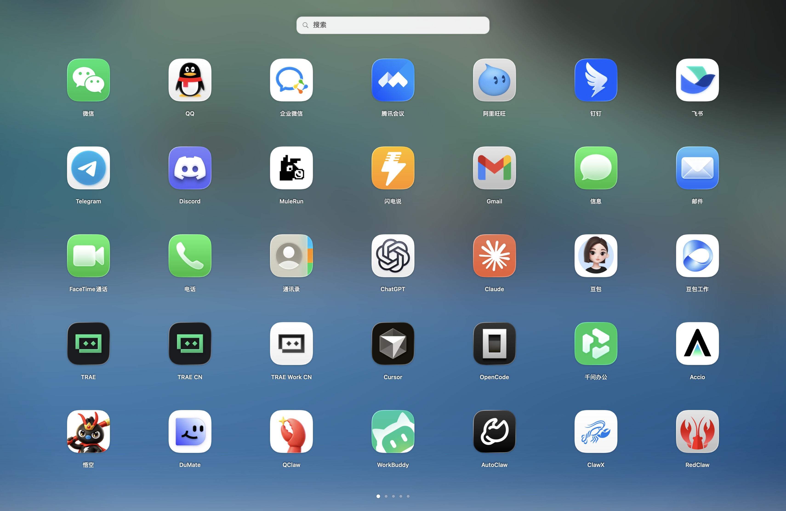

# 启动台

macOS Tahoe 把全屏启动台换成了窗口里的「应用程序」。这个项目把以前的全屏启动台带回来：模糊的桌面壁纸、一页一页的图标，点一下就打开。



## 使用

编译完成后打开「启动台」，也可以点菜单栏上的图标。快捷键是 **Control + Option + 空格**。

- 在触控板上左右滑动翻页，页面跟着指头走。到第一页或最后一页再往外拉，会轻轻回弹。
- 顶部可以搜索，中文和拼音都行。
- 图标按类型排在一起，同一家的挨着放，不会收进文件夹。
- 从图标到名字都可以点，范围比图标略大一点。点图标之间的空白，效果和按 Esc 一样。
- 可以拖动调整顺序，也可以放进文件夹，或从启动台里隐藏。

## 编译

需要 macOS 13 或更新的系统。

```bash
./build.sh
open 启动台.app
```

编译结果在项目目录里，应用名字是「启动台」。

## 许可

[MIT](LICENSE)
